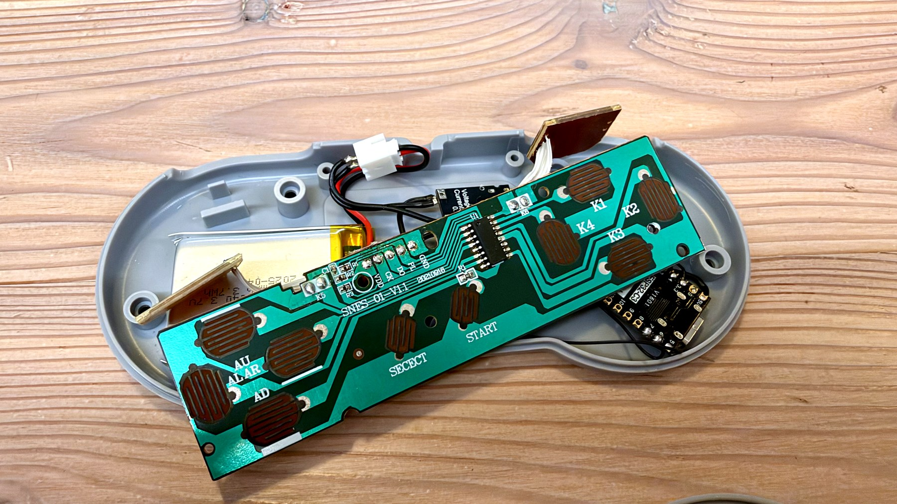
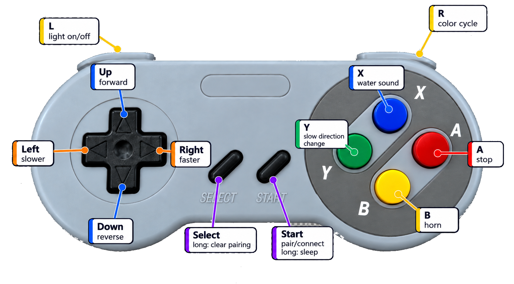

# ESPTrain - SNES Bluetooth Controller for LEGO DUPLO 10874

ESPTrain turns an aftermarket SNES-style controller into a BLE remote for an unmodified LEGO DUPLO 10874 train. An ESP32-C3 SuperMini reads the controller PCB through the SNES serial interface and sends LEGO Wireless Protocol commands over Bluetooth Low Energy. 🚂🎮



## 🚂 Built for Little Hands, with Room to Grow

This repository documents the first working version of ESPTrain. After patiently waiting long enough for their train controller, my kids were more than ready to finally get their hands on it! 😄

So, rather than spending more time perfecting every detail, I focused on getting a reliable, functional controller up and running. Sometimes, getting something into little hands is more important than getting everything perfect on the first try.

This is just the beginning, though! Future improvements may include a custom piggyback PCB, buzzer, status LED, battery monitoring, and a cleaner internal layout.

**For now, the train is running, the kids are happy, and that's what matters most!** 🚂✨

## Features

- ESP32-C3 Arduino firmware
- Aftermarket SNES-compatible controller PCB read through `VDD`, `GND`, `CK`, `PL`, and `DO`
- BLE pairing and reconnect for the DUPLO train
- Forward/reverse driving, speed steps, stop, horn, water sound, light toggle, and light color cycling
- Prepared optional buzzer, LED, battery monitoring, inactivity sleep, and wakeup pin support

## Controls



Short version:

| Button | Action |
| --- | --- |
| Up | Start or keep driving forward |
| Down | Start or keep driving backward |
| Right | Increase speed |
| Left | Decrease speed |
| A / red | Stop |
| B / yellow | Horn |
| X / blue | Water sound |
| Y / green | Slow direction change |
| L | Toggle light |
| R | Cycle light color |
| Start | Pair/connect; long press sleeps |
| Select long | Clear saved pairing |

More detail: [Controls and pairing](docs/CONTROLS.md)

## Hardware

Current simple build:

- ESP32-C3 Development Board ESP32 SuperMini
- Amazon aftermarket SNES-style controller PCB and shell
- 803040 3.7 V LiPo battery
- USB-C LiPo charger/protection module
- Hookup wire, connector, insulation, and hot glue

Detailed bill of materials: [BOM](docs/BOM.md)  
Wiring and hardware notes: [Hardware notes](docs/HARDWARE.md)

## Build And Upload

Open `ESPTrainArduino/ESPTrainArduino.ino` in Arduino IDE 2.x.

Recommended board settings:

| Setting | Value |
| --- | --- |
| Board package | `esp32` by Espressif Systems |
| Board | `ESP32C3 Dev Module` |
| USB CDC On Boot | `Enabled` |
| Serial Monitor | `115200` baud |
| Flash Size | usually `4MB` |

Arduino CLI build check:

```sh
arduino-cli compile --fqbn 'esp32:esp32:esp32c3:CDCOnBoot=cdc' ESPTrainArduino
```

## Code Layout

| File | Responsibility |
| --- | --- |
| `ESPTrainArduino/ESPTrainArduino.ino` | Arduino setup/loop and top-level state handling |
| `ESPTrainArduino/SnesController.*` | SNES serial protocol and button events |
| `ESPTrainArduino/TrainController.*` | Button mapping and train behavior |
| `ESPTrainArduino/LegoDuploTrain.*` | BLE scan, pairing, reconnect, and LEGO commands |
| `ESPTrainArduino/PowerManager.*` | Inactivity, optional battery monitor, sleep path |
| `ESPTrainArduino/Buzzer.*` | Optional button/audio feedback |
| `ESPTrainArduino/Config.h` | Pins, timings, feature flags, ports, sound IDs |

## Status

The firmware is usable in the current simple build. The next hardware step is a small piggyback PCB for cleaner wiring and optional feedback parts.

No license has been selected yet.
