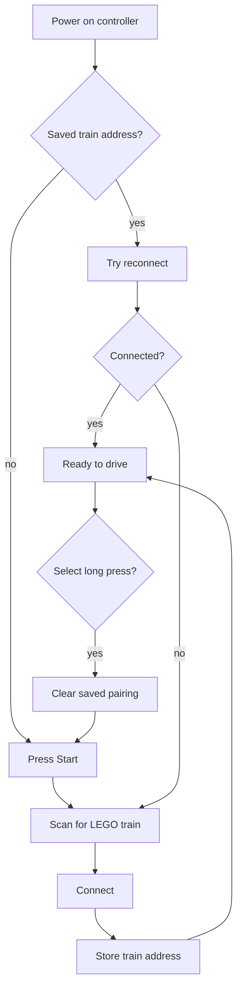
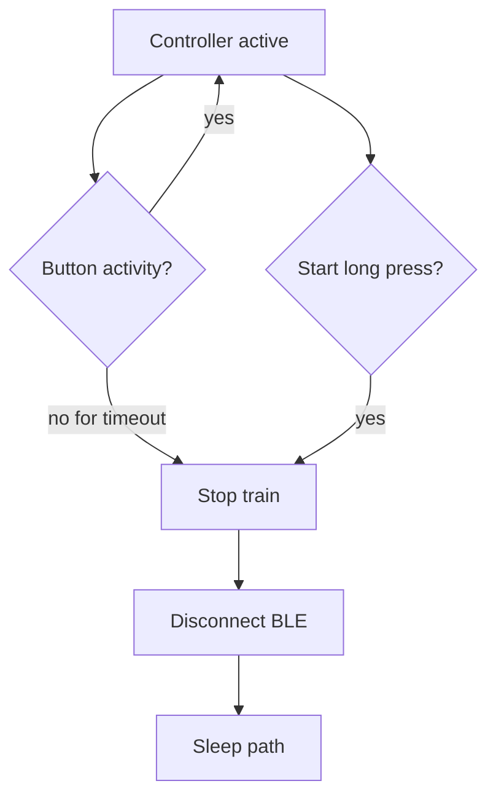

# Controls And Pairing

ESPTrain is designed as a child-friendly train remote: the train keeps moving after a direction button is tapped, and speed changes are stepped.

## Button Map

| Button | Short press | Long press |
| --- | --- | --- |
| Up | Start or keep driving forward | Same as held |
| Down | Start or keep driving backward | Same as held |
| Right | Increase speed by one level | Repeats while held |
| Left | Decrease speed by one level | Repeats while held |
| A / red | Stop | Emergency stop behavior |
| B / yellow | Horn | Horn |
| X / blue | Water sound | Water sound |
| Y / green | Slow direction change | Slow direction change |
| L | Toggle train light | Toggle train light |
| R | Cycle light color | Cycle light color |
| Start | Pair/connect if needed | Put controller to sleep |
| Select | Reserved | Clear saved train pairing |

## Driving Behavior

- Up starts forward movement using the configured start speed if the train is stopped.
- Down starts reverse movement using the configured start speed if the train is stopped.
- Right increases the current speed one logical level.
- Left decreases the current speed one logical level toward zero.
- The train does not require holding Up or Down to keep moving.
- Y performs a slow direction change: stop first, pause briefly, then restart slowly in the opposite direction.

## Pairing Flow

The current firmware uses Start for pairing/reconnect and a long Select press to clear the saved train address. An earlier planning idea used `L + R + Select` combinations with Start confirmation, but that is not the active behavior in this repository.

## Sleep Flow

Deep sleep is disabled by default while testing over USB. Enable it in `Config.h` after a real wakeup button wire is available.
