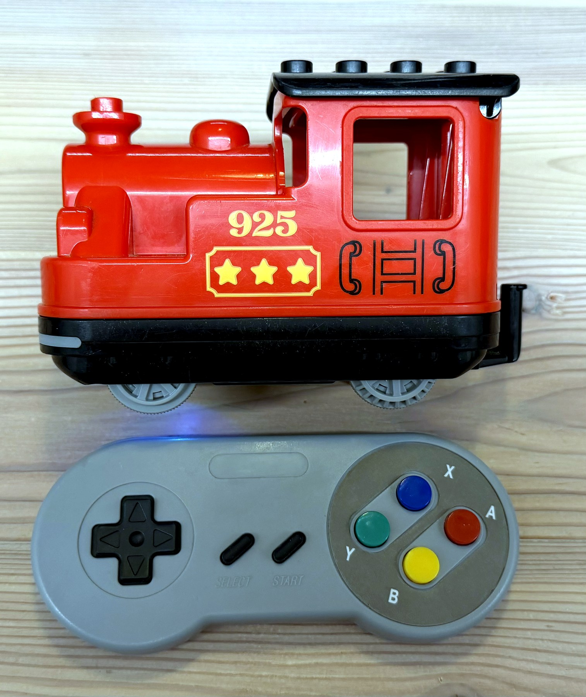
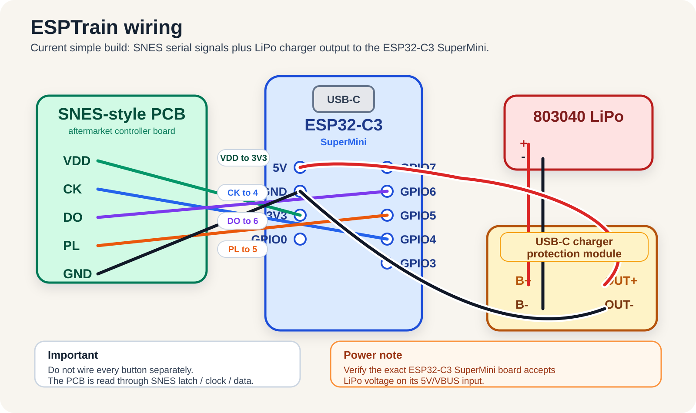
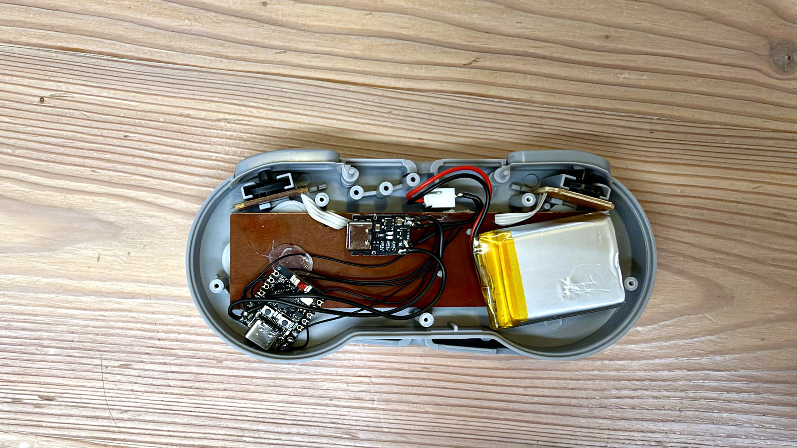

# Hardware Notes

ESPTrain places an ESP32-C3 SuperMini inside an aftermarket SNES-style controller shell and keeps the LEGO DUPLO 10874 train base unmodified. The current build is intentionally simple: it is a working quick version, not the final neat PCB revision.

## Current Wiring

Aftermarket SNES-compatible controller PCB to ESP32-C3:

| Controller PCB | ESP32-C3 SuperMini |
| --- | --- |
| `VDD` | `3V3` |
| `CK` | `GPIO4` |
| `DO` | `GPIO6` |
| `PL` | `GPIO5` |
| `GND` | `GND` |

Power wiring:

| Signal | Connection |
| --- | --- |
| Battery + | Charger/battery module `B+` |
| Battery - | Charger/battery module `B-` |
| Charger/module `OUT+` | ESP32-C3 `5V` |
| Charger/module `OUT-` | ESP32-C3 `GND` |

The SNES controller PCB must be read through the serial latch/clock/data interface. Do not wire every button separately.

## Power Input Check

The simple build feeds the ESP32-C3 SuperMini through its `5V` pin from the charger/protection module output. This matches the current physical build, but it should still be verified for the exact ESP32-C3 SuperMini board variant: a single LiPo cell is about 3.0 V to 4.2 V, not a regulated 5 V supply.

Before making a polished PCB revision, confirm one of these options:

- the selected ESP32-C3 SuperMini board reliably runs from LiPo voltage on its `5V`/VBUS input, or
- add a suitable regulator/boost path, or
- feed the module through the correct regulated input recommended for that board.

## Simple Build Notes

- The 803040 LiPo battery sits inside the controller shell.
- The ESP32-C3 SuperMini is mounted in the right side of the shell.
- The charger/protection module sits in the shell and currently feeds the ESP32-C3 `5V` input.
- The controller PCB is temporarily wired with thin hookup wire.
- Hot glue and insulation are used in the current quick build.
- A future piggyback PCB should make this more robust and repeatable.

## Optional Hardware Connections

| Feature | Suggested ESP32-C3 pin | Notes |
| --- | --- | --- |
| Passive buzzer driver | `GPIO7` | Use transistor or MOSFET driver |
| Status LED | `GPIO10` | Use a resistor; keep separate from buzzer |
| SK6812 MINI-E RGB LED | `GPIO7` through 330 ohm | Earlier plan; currently not installed |
| Battery divider ADC | `GPIO0` | 100k/100k divider, firmware multiplies ADC voltage by 2 |
| START wakeup wire | configurable, default `GPIO3` | Only enable after wiring a wake-capable GPIO |

## Piggyback PCB Checklist

- Route SNES `VDD`, `GND`, `CK`, `PL`, and `DO` to labeled pads.
- Keep SNES serial traces short.
- Add test pads for all SNES serial signals.
- Use separate GPIOs for LED and buzzer.
- Drive low-impedance buzzers with an NPN transistor or small MOSFET.
- Add a flyback diode if the buzzer is electromagnetic.
- Place the battery divider behind a solder bridge, jumper, or high-side switch.
- Expose `3V3`, `5V/OUT+`, `GND`, `BAT_ADC`, `BOOT`, and `EN/RST` test pads.
- Keep charger and battery current paths away from SNES signal routing.
